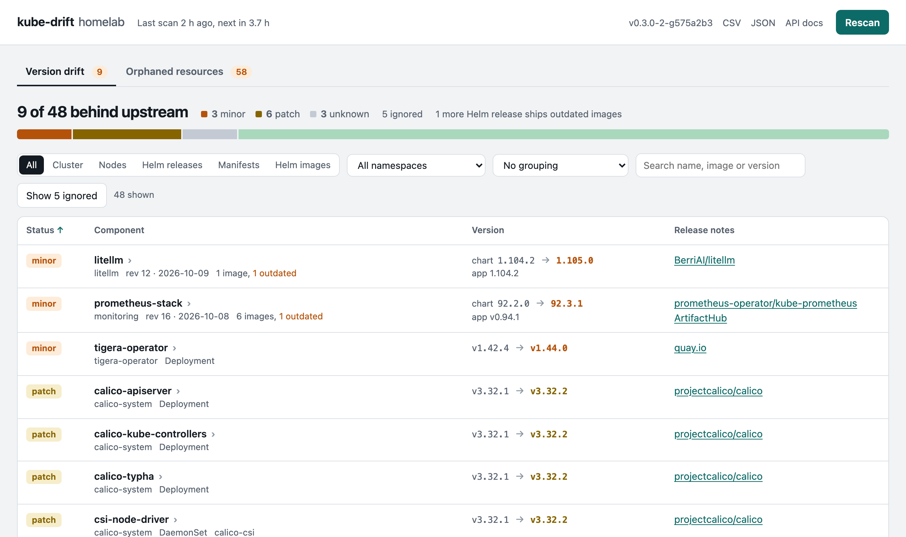
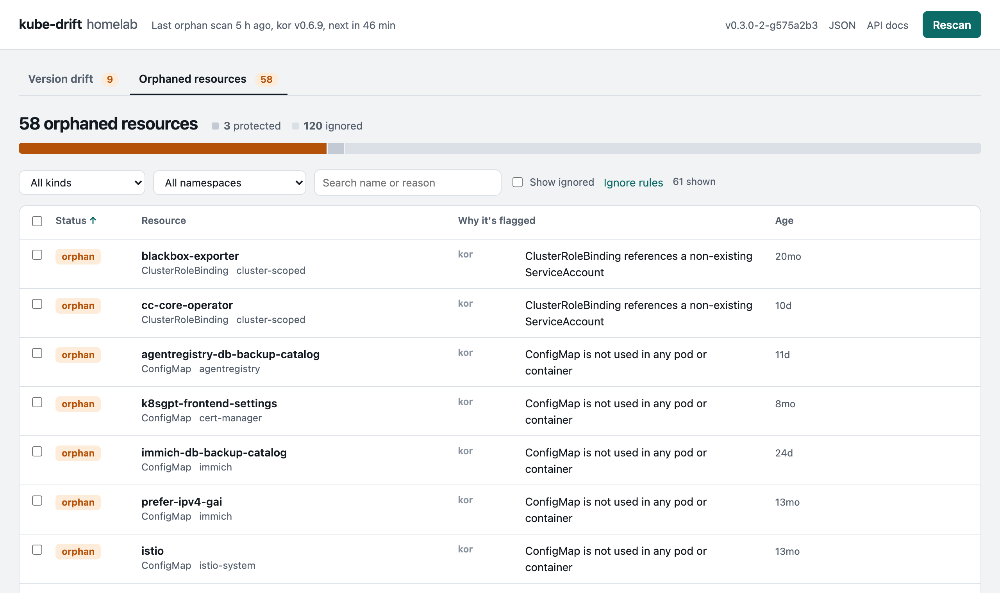

# kube-drift

A dashboard for the two kinds of drift a long-lived Kubernetes cluster collects:

- **Version drift** — everything installed (control plane, nodes, Helm releases, plain
  manifests), what upstream has released since, and where to read the release notes.
- **Orphaned resources** — ConfigMaps, Secrets, RoleBindings, PVCs… that nothing uses any more,
  found by [kor](https://github.com/yonahd/kor) and cross-checked so you can tell real leftovers
  from things kor can't see being used.

It runs in the cluster, rescans on a timer, and **never changes the cluster**. With [Renovate](#renovate)
connected, it shows which updates Renovate already has and can approve one: that ticks a box in a
Dependency Dashboard issue on your forge, never anything in the cluster.
Cleanup is a kubectl script it writes for you to review and run.

> [!NOTE]
> kube-drift shows your cluster's full inventory. Sign-in is built in (OIDC, plus API keys for
> scripts) but off until you configure it. Turn it on, or put kube-drift behind an
> authenticating gateway, before anyone else can reach it, and keep it on your private network.
> See [Exposing it](#exposing-it).

<picture>
  <source media="(prefers-color-scheme: dark)" srcset="docs/versions-dark.png">
  
</picture>
<picture>
  <source media="(prefers-color-scheme: dark)" srcset="docs/orphans-dark.png">
  
</picture>

## Quick start

```bash
kubectl apply -k 'https://github.com/opswhisperer/kube-drift//deploy/base?ref=main'
kubectl -n kube-drift port-forward svc/kube-drift 8080:80
```

Open <http://localhost:8080> — port-forward is safe because only you can reach it. The first version scan takes under a minute; the orphan scan a few
minutes (kor lists every kind in every namespace).

You need a default StorageClass (kube-drift keeps its state on a 1Gi PVC). Images are published
for `linux/amd64` and `linux/arm64`.

## Configure

kube-drift needs no configuration to start: it finds every release, workload and orphan on its
own, looks Helm charts up on ArtifactHub by name, and compares images with newer tags in their
registry. Add a config file when the dashboard shows you something wrong or noisy:

| On the dashboard | Add to `config.yaml` |
|---|---|
| A Helm release is **unknown**, or "Available" belongs to a different chart | `helm:` — where that chart is really published |
| A chart Argo CD deploys is missing, stuck at an old version, or its workloads show as "Manifest" | `argocd:` — `enabled: true`, plus the RBAC component, see [Argo CD](#argo-cd) |
| "Available" is a major upgrade you can't take yet | `track: major` on that image (`images:`) or release (`helm:`) |
| An app on `latest`/`main` only says "newer image behind tag" | `probes:` — ask the app for its version over HTTP |
| Images from your own registry show HTTP 401 | no config: a pull secret, see [Registry credentials](#registry-credentials) |
| Images from a plain-HTTP registry show an SSL error | `registries:` — `insecure: true` |
| Rows you'll never act on | `ignore:` (workloads), `ignore_images:` (sidecars), `groups:` (many generated copies → one row) |
| Orphans that are fine | `orphans.ignore:` — or **Ignore** in the dashboard |

[`config/example.yaml`](config/example.yaml) explains each key with examples. Copy it, keep what
you need.

The dashboard's **Config** tab shows the config kube-drift is running with. Values that look
secret, probe headers and passwords in URLs show as `(hidden)`. The tab also lists which rows
each `images:` and `helm:` rule matched in the last scan. Image and Helm rules can be added or
overridden there too: press **Configure…** on a row in Version drift, or **Add** in the tab.
Those rules are kept on kube-drift's volume (`overrides.json`). Each one replaces the config
file's entry for the same key until you revert it, and saving one starts a version rescan.
**Copy YAML** gives you them in config-file form, so you can move them into git. Everything else
(sign-in, probes, registries, ignores, orphans) is only changed in the config file.

### Applying your config

The config is a file called `config.yaml` that Kustomize turns into the ConfigMap kube-drift
reads. Make a directory with two files:

```yaml
# my-kube-drift/kustomization.yaml
resources:
  - https://github.com/opswhisperer/kube-drift//deploy/base?ref=main   # kube-drift itself
configMapGenerator:
  - name: kube-drift-config     # replace the base's default config…
    behavior: replace
    files:
      - config.yaml             # …with this file
```

```yaml
# my-kube-drift/config.yaml
cluster_name: prod-eu                # shown in the dashboard header

helm:
  # the ArtifactHub search for "postgresql" picked the wrong chart; this release is Bitnami's
  db: { source: { type: artifacthub, repo: bitnami, chart: postgresql } }

images:
  mongo: { track: major }            # we're staying on MongoDB 8 for now: don't offer 9

ignore:
  - { namespace: default, name: debug-shell }   # a scratch pod, not worth tracking

orphans:
  kubectl_context: prod-eu           # the cleanup commands it writes target this context
  ignore:
    - { kind: Secret, source: cert-manager, why: cert-manager owns its certificates }
```

Then `kubectl apply -k my-kube-drift/`. To change the config, edit `config.yaml` and apply again;
the pod restarts by itself (the ConfigMap's name includes a hash of its contents).

The same directory is where the rest of your customisation goes: another namespace
(`namespace:`, plus a `$patch: delete` for the base's Namespace), your own image build
(`images:`, and a patch adding `imagePullSecrets`), and an Ingress or Gateway.

### Argo CD

Argo CD installs Helm charts by rendering them itself (`helm template`), so it never writes the
Helm release Secrets kube-drift reads releases from. Without help, a chart deployed only by an
Argo CD Application isn't listed as a release, its workloads show as plain manifests, and a chart
you moved from `helm install` to Argo CD stays at the version Helm last installed (the old
Secret is left behind). To read Applications instead, turn it on in `config.yaml` and give
kube-drift get/list on `applications.argoproj.io` with the optional component:

```yaml
# my-kube-drift/config.yaml
argocd:
  enabled: true
  namespaces: [argocd]          # where your Application objects live; Argo CD's own first
```

```yaml
# my-kube-drift/kustomization.yaml
resources:
  - https://github.com/opswhisperer/kube-drift//deploy/base?ref=main
components:
  - https://github.com/opswhisperer/kube-drift//deploy/components/argocd?ref=main
```

The component adds one rule to kube-drift's read-only ClusterRole; it isn't in `deploy/base`
because Applications can carry inline Helm values, and a cluster without Argo CD has no reason
to grant read on them. It's off by default: without `argocd.enabled`, no Application is read and
the scan is exactly what it was. If the Applications can't be listed (no CRD, no RBAC), the
dashboard says so next to the scan time and the release Secrets still count.

Optional: a Secret named `kube-drift-credentials` in kube-drift's namespace with a
`github-token` key raises the GitHub API limit from 60 to 5000 requests an hour, for chart and
probe lookups that use GitHub releases.

### Registry credentials

Registries that want credentials even to read tags (your own registry, private repos, Docker
Hub's rate limit) need no config change: give kube-drift a standard pull secret named
`kube-drift-registry-auth` in its namespace. `deploy/base` mounts it if it exists.

```bash
kubectl -n kube-drift create secret docker-registry kube-drift-registry-auth \
  --docker-server=registry.example.com --docker-username=reader --docker-password=…
```

Or copy a pull secret you already have, renamed; for several registries, put them all in one
`.dockerconfigjson` and create the Secret with
`--from-file=.dockerconfigjson=config.json --type=kubernetes.io/dockerconfigjson`. Hosts match
as the kubelet matches them (`docker.io` under any of its names, longest path prefix), the
Secret is re-read when it changes, and a read-only token is enough. kube-drift doesn't borrow
the scanned pods' own `imagePullSecrets`. The older per-registry `auth_env` setting under
`registries:` still works and wins for its host; see
[`config/example.yaml`](config/example.yaml).

### Exposing it

kube-drift never changes the cluster and never returns Secret data, but what it reports is
still sensitive: every workload, image, version and Helm release, and the names of your
Secrets, ConfigMaps and RoleBindings, which together map out your cluster. Anyone who can use it
can also change its ignores and rules and start scans. Sign-in is off until you configure it, so
until then, anyone who can reach the service can do all of that.

**Keep it private.** Even with sign-in on, serve it on your LAN, VPN or tailnet rather than the
public internet. Sign-in is the lock; not publishing it is the fence.

**Use built-in sign-in, or authentication in a gateway**, described below.

#### Built-in sign-in

With sign-in on:

- **people** sign in with your OIDC provider (Authentik, Keycloak, Dex, Entra ID, Google…). You
  can limit it to some groups or email addresses;
- **scripts and agents** send an API key: `Authorization: Bearer kd_…`. Signed-in people make
  and revoke keys under **API keys** in the dashboard header. Each key is shown once; kube-drift
  keeps only its SHA-256, on its volume. A key can do what the dashboard can, except manage keys;
- `/healthz`, `/readyz`, `/openapi.json`, `/docs` and `/icon.svg` stay open. Everything else
  needs a sign-in or a key: the dashboard redirects to your provider, and `/api/…` answers 401.

Sign-in is set up in the config file and a Secret, not in the dashboard. That way, nobody who
reaches the dashboard can switch it off. It takes four steps.

**1. Register kube-drift with your provider** as a confidential OAuth2/OIDC client:

| Setting | Value |
|---|---|
| Client type | Confidential (it has a client secret) |
| Redirect URI | `https://<kube-drift's host>/auth/callback`, exactly: https, no trailing slash |
| Scopes | `openid profile email` |
| Groups | if you'll use `allowed_groups`, the ID token must carry a `groups` claim |

In **Authentik**: Applications → Providers → Create → OAuth2/OpenID Provider.

- Authorization flow: `default-provider-authorization-implicit-consent`.
- Client type: Confidential. Client ID: `kube-drift`.
- Redirect URIs: Strict, `https://<kube-drift's host>/auth/callback`.
- Signing key: any.
- Leave the default scopes. Authentik's `profile` scope sends `groups`.
- Keep **Include claims in id_token** on.

Then create an Application with the slug `kube-drift` that uses this provider. The issuer URL is
`https://<authentik>/application/o/kube-drift/`. Its `.well-known/openid-configuration` should
load in a browser.

**2. Give kube-drift the client secret.** The Deployment reads `oidc-client-secret` from the
`kube-drift-credentials` Secret into `OIDC_CLIENT_SECRET`:

```bash
kubectl -n kube-drift create secret generic kube-drift-credentials \
  --from-literal=oidc-client-secret='<client secret>'
```

If that Secret already exists (for `github-token`), add the key to it instead, or manage the
Secret with External Secrets.

**3. Turn it on in the config** (`auth:` in [`config/example.yaml`](config/example.yaml) lists every
option):

```yaml
auth:
  oidc:
    issuer: https://auth.example.com/application/o/kube-drift/
    client_id: kube-drift
    redirect_url: https://drift.example.com/auth/callback   # the same URI as in step 1
    allowed_groups: [kube-drift-admins]                    # optional; or allowed_emails
```

With neither `allowed_groups` nor `allowed_emails`, anyone your provider signs in gets in. In that
case, restrict access in the provider instead, for example with an Authentik application binding.

**4. Deploy and check.** The log should say `sign-in: OIDC via <issuer>`. Then:

```bash
curl -s https://drift.example.com/auth/me         # {"auth": "oidc", "via": null, ...}
curl -s -o /dev/null -w '%{http_code}\n' https://drift.example.com/api/drift   # 401
```

Open the dashboard and sign in. **API keys**, your name and **Sign out** appear in the header.

**API keys.** Under **API keys**, name the key after what will use it, pick an expiry, and copy
the key; it's shown only once. Keep it in a password manager or secret store, not in a file:

```bash
curl -H "Authorization: Bearer $KUBE_DRIFT_API_KEY" https://drift.example.com/api/drift
```

Revoking a key in the same dialog takes effect at once.

**If something goes wrong:**

| What you see | Why |
|---|---|
| The provider says the redirect URI is invalid or mismatched | Its redirect URI isn't exactly `redirect_url`. Check https, the trailing slash, the `/auth/callback` path |
| kube-drift's "Not allowed" page | You're not in `allowed_groups`/`allowed_emails`, or the ID token has no `groups` claim (in Authentik, keep "Include claims in id_token" on) |
| The pod won't start: `auth.oidc: the client secret env var OIDC_CLIENT_SECRET is empty` | Step 2 is missing. kube-drift refuses to start rather than run without sign-in |
| "Can't reach the identity provider" | kube-drift can't fetch `<issuer>/.well-known/openid-configuration`: check the issuer URL, and DNS and egress from the pod |
| Removed from the group but still signed in | Sessions last `session_hours` (12 by default). The group is checked again at the next sign-in |

Sessions are HMAC-signed cookies. To share them between replicas, set `SESSION_SECRET`;
otherwise kube-drift keeps a key on its volume. A gateway in front still makes sense for TLS. A
NetworkPolicy that only admits traffic from the gateway's namespace keeps other pods from calling
kube-drift directly.

#### Authentication in a gateway

With built-in sign-in off:

- **People:** single sign-on in front of it: oauth2-proxy, your ingress controller's OIDC
  support (Envoy Gateway and Istio have it built in), or an identity-aware proxy.
- **Agents and scripts:** API keys or JWTs checked by the same gateway (for example an Envoy
  Gateway `SecurityPolicy`).
- **Inside the cluster:** the gateway is the front door, but any pod can call the Service
  directly. Add a NetworkPolicy that only admits traffic from your gateway's namespace.
- **Not enough on their own:** an unauthenticated Ingress or LoadBalancer, an IP allowlist, or
  a hostname nobody knows. A VPN without sign-in is fine only if everyone on it should see your
  cluster's inventory.

### Renovate

If [Renovate](https://docs.renovatebot.com/) keeps your manifests and chart pins current, kube-drift can be
its inbox: each row it can match says what Renovate has for it, and an update waiting for approval gets an
**Upgrade** button. Every row with an image or a chart shows one of:

| On the row | Means |
|---|---|
| **Upgrade to v…** | Renovate waits for approval in the repository's Dependency Dashboard. The button ticks that box (as you would on the forge), and Renovate opens the PR on its next run |
| **Renovate PR #n** | the PR is open (a link) |
| **Renovate: …** | Renovate has the branch planned but waits (schedule, rate limit), or you just approved it |
| expanded: *tracked* / *not tracked by Renovate* | Renovate watches it with nothing pending, or doesn't know it at all (a gap in its config) |

**1. Turn it on.** In the config:

```yaml
renovate:
  enabled: true
  forge:
    type: forgejo                  # forgejo, gitea or github
    url: https://git.example.com   # github: https://github.com (default), or your GitHub Enterprise URL
  dashboard_title: "Dependency Dashboard"   # Renovate's dependencyDashboardTitle, if you changed it
```

**2. Send it Renovate's report after every run.** Run Renovate with `reportType: file` (and `reportPath`),
then POST that file to kube-drift with an API key (or through your authenticating gateway). In a CI job:

```bash
renovate   # with RENOVATE_REPORT_TYPE=file RENOVATE_REPORT_PATH=/tmp/renovate-report.json
curl -fsS -H "Authorization: Bearer $KUBE_DRIFT_API_KEY" -H 'Content-Type: application/json' \
  --data-binary @/tmp/renovate-report.json https://kube-drift.example.com/api/renovate/report
```

A report for some repositories (a run limited with `repositories`) replaces just those; the others stay.

**3. Optional: approving.** Put a token that may edit issues in the repositories Renovate manages into
`kube-drift-credentials`, key `renovate-forge-token` (`RENOVATE_FORGE_TOKEN`). Without it the rows still
show Renovate's state, and approving stays on the forge. Use a bot account with issue write only: kube-drift
edits nothing else. Want the PR at once instead of at Renovate's next scheduled run? Start Renovate from a
workflow on the dashboard issue's `edited` event.

**Matching:** an image by name (with or without its registry, so `quay.io/org/app` is Renovate's `org/app`)
and tag; a chart by name and installed version. When the same image and tag are in several repositories,
kube-drift takes the one the row's namespace is synced from, if [`argocd:`](#argo-cd) is on.

## Version drift

| Category | Installed version from | Available version from |
|---|---|---|
| Cluster | `/version`; static pods in `kube-system` (etcd, kube-vip, apiserver…) | `dl.k8s.io/release/stable-<minor>.txt` and `stable.txt`; registry tags |
| Nodes | kubelet and container runtime per node | Kubernetes stable pointer; GitHub `containerd/containerd` |
| Helm releases | Helm v3 release Secrets (chart version + appVersion) | ArtifactHub, an OCI chart repo, or GitHub releases |
| Helm releases from Argo CD (opt-in, [`argocd:`](#argo-cd)) | each Application source with `chart:`: release name from `helm.releaseName`, namespace from `helm.namespace` or the destination; the version Argo CD deployed (`status.sync.revision`, or the matching `revisions[i]` for several sources; while out of sync, the last deployment in its history). Not deployed yet: the target revision, marked "not synced yet". appVersion comes from the chart's ArtifactHub or OCI metadata. Replaces a release Secret of the same name and namespace | a Helm repository: ArtifactHub, preferring the repository the Application names; an OCI repository: its chart tags. `helm:` rules apply as for Secret releases |
| Manifests | every Deployment/StatefulSet/DaemonSet not owned by Helm (including those of Argo CD Applications with git sources) | newest registry tag of the same shape as the running tag |
| Helm-managed workloads | the images inside Helm releases: listed and counted under their release (click it to expand), since the chart upgrades them. For Argo CD, the workloads its `argocd.argoproj.io/tracking-id` annotation (or the Application's resource list) ties to a Helm source | same as manifests |

Pinned tags are matched by shape: `v1.35.9` only considers `vX.Y.Z` tags, `9.0-alpine` only
`X.Y-alpine`, `distroless-v1.39.1` only `distroless-vX.Y.Z`. `track: minor|major` limits the
answer to the installed minor/major and shows the unrestricted one as "newer track".
Prereleases are ignored.

A chart update whose `kubeVersion` excludes the control plane's version is marked incompatible,
with the reason. The range comes from ArtifactHub, or for an OCI chart from the chart's metadata
in its registry (a small config blob, cached by digest; the chart itself isn't pulled). The
dashboard hides those rows until you press "Show N incompatible".

To put off an update, expand its row and press "Ignore this update…". It stays hidden until the
first of the conditions you pick: the next version coming out (for a floating tag, its image
changing again), a number of days, or the cluster's Kubernetes version changing. Ignores are kept on
kube-drift's volume (`update-ignores.json`) and are also available through the API (`/docs`).

Floating tags (`latest`, `main`, `nightly`…) carry no version, so the running image digest is
compared with the registry's current digest for that tag ("newer image behind tag"). Apps that
report their version over HTTP can be asked directly with `probes`.

An image the manifest pins by digest (`repo:tag@sha256:…`) is compared on that pin instead, because
the digest a kubelet reports for a pinned image is often a different one for the same content —
containerd keeps more than one index digest per image — which would leave the row stale for ever.
Whether a pod has caught up with the pin is a rollout question your GitOps tool already answers.

## Orphaned resources

kor does the detection. By default kube-drift runs everything `kor all` checks except CRDs
(slow, and mostly operator-installed CRDs), with `--ignore-owner-references` — anything with an
owner is garbage-collected with it, so it is never really orphaned — and `--older-than=1h`, so
nothing mid-rollout is flagged.

Then it adds what kor doesn't check. Each row shows kor's reason (tagged **kor**) and
kube-drift's evidence (**In use**, **Recreated**, **Leftover**):

| Status | Meaning |
|---|---|
| orphan | nothing uses or manages it. **Leftover** means the Helm release that created it is no longer installed |
| in use | kor is wrong: something it doesn't check uses it — a Gateway's TLS `certificateRefs`, a cert-manager issuer's secret refs |
| managed | its owner would put it back if deleted: an installed Helm release, a cert-manager Certificate, Argo CD, a `managed-by` label. Remove it at the source instead |
| protected | never gets a delete command: `system:*`/`kubeadm:*` objects, kubeadm and `kube-root-ca.crt` ConfigMaps, kube-drift itself, plus your `protect` rules |
| ignored | you ignored it, or an ignore rule matches |

**Ignore** a resource, or everything like it: the dialog offers rules built from your selection
with live match counts — "Secrets issued by cert-manager (65)", "ConfigMaps in apps" — that
also cover future findings. Rules match on `kind`, `namespace`, `name`, `name_regex` and `source`
(the evidence: `cert-manager`, `gateway`, `cert-manager-issuer`, `helm`, `helm-leftover`,
`argocd`, `managed-by:<name>`). Rules made in the dashboard live on its PVC and can be removed
under "ignore rules"; rules in the config file work the same way.

**Export** and **Delete** give you a script to copy into a terminal with your own kubectl
access (needs `kubectl` and `jq`). It saves each object to
`kube-drift-{export,backup}-<timestamp>/<Kind>_<namespace>_<name>.json`, with server-owned
fields stripped so `kubectl apply -f <dir>/` restores it, and the delete script removes each
object only after its backup succeeded, stopping at the first failure. Secret backups contain the
secret data and are written with mode 600. A PVC or PV backup is the manifest, not the data.

## Security

- **Authentication**: built-in OIDC sign-in and API keys, or an authenticating gateway; see
  [Exposing it](#exposing-it). Sessions are HMAC-signed cookies (`HttpOnly`, `SameSite=Lax`,
  `Secure` over https) keyed by `SESSION_SECRET` or a key kube-drift keeps on its volume.
- **Read-only RBAC**: `get`/`list` on what the scans read, cluster-wide. That includes Secrets:
  Helm stores releases as Secrets, and kor checks whether Secrets are used. Kubernetes RBAC
  can't limit a list to one Secret type or label. Remove `secret` from `orphans.resources` to
  keep kor out of Secrets; the Helm scan still reads them. Argo CD Applications are only read
  with the optional `deploy/components/argocd`; their Helm values are never returned.
- The dashboard and API never return Secret data — only names.
- Runs as non-root with a read-only root filesystem and no capabilities.
- Image and Helm rules made in the dashboard can point version lookups at any OCI registry or
  GitHub repository. Anyone who can use the dashboard can make them, so they get the same
  protection as ignores. Settings that make kube-drift send credentials or headers (sign-in,
  probes, registries) can't be changed from the dashboard.
- POST endpoints change only kube-drift's own state (including API keys), and accept
  `application/json` only, so a cross-site form can't reach them.

## API

Described by OpenAPI 3.1 at `/openapi.json`, with an interactive reference at `/docs` (also the
**API** button in the dashboard). API responses carry `Link: </openapi.json>; rel="service-desc"`,
so tools and agents can discover it from any endpoint.

`/api/drift` lists every row the dashboard shows, ignored ones and each image a Helm release
ships included. For just what `summary.outdated` counts, say for a status tile, ask for
`/api/drift?status=outdated&ignored=false&top=true`.

| | |
|---|---|
| `GET /api/drift[?status=…&ignored=…&top=…]` | version scan (JSON); the filters narrow `components` only |
| `GET /api/drift.csv[?…]` | version scan (CSV), same filters |
| `GET /api/orphans` | orphan scan, with ignores and rules applied |
| `POST /api/rescan[?scope=versions\|orphans]` | rescan now |
| `POST /api/orphans/ignore`, `/unignore` | `{ids, note}` |
| `POST /api/orphans/rules`, `/rules/delete` | `{rule, note}`, `{id}` |
| `POST /api/orphans/commands` | `{ids, action: export\|delete}` → `{script, skipped}` |
| `GET /api/keys`, `POST /api/keys`, `/api/keys/delete` | list, `{name, days?}` → `{token, key}`, `{id}`; signed-in people only |
| `GET /auth/me` | `{auth: oidc\|none, via, user, key}`: is sign-in on, and who's calling |
| `GET /auth/login`, `/auth/callback`, `POST /auth/logout` | browser sign-in and sign-out |
| `GET /healthz`, `/readyz` | liveness; readiness (503 until the first version scan) |
| `GET /openapi.json`, `/docs` | this API, as OpenAPI 3.1 and as Swagger UI |

Environment: `CONFIG` (`/config/config.yaml`), `CLUSTER_NAME` (overrides the config),
`SCAN_INTERVAL_HOURS`, `DATA_DIR` (`/data`), `GITHUB_TOKEN`, `OIDC_CLIENT_SECRET`,
`SESSION_SECRET` (optional; set it to share sessions between replicas), `REGISTRY_AUTH_FILE`
(`/etc/kube-drift/registry/.dockerconfigjson`, a Docker config JSON; `""` for none), plus any
`auth_env` you name under `registries`.

## Development

Python 3.12 and PyYAML; `kor`, `kubectl` and `jq` for the full picture.

```bash
pip install -r requirements.txt
python3 -m unittest discover -s tests -p 'test_*.py'

# against a frozen snapshot of a real cluster, no cluster access needed
python3 -m tests.offline              # version scan, real upstream lookups
python3 -m tests.offline --orphans    # orphan scan against a recorded kor result

# against your current kubectl context
kubectl proxy &
KUBE_API=http://127.0.0.1:8001 CONFIG=config/example.yaml DATA_DIR=/tmp/kube-drift \
  python3 -m app.main                 # http://localhost:8080
```

```
app/main.py      HTTP server, scan schedulers, ignore/rule/command/config endpoints
app/scan.py      version scan: inventory → components → upstream versions
app/orphans.py   orphan scan: kor, evidence, ignore rules, cleanup scripts
app/upstream.py  registries (Docker Hub, ghcr, quay, generic v2), ArtifactHub, GitHub
app/k8s.py       minimal Kubernetes API client, Helm release decoding
app/argocd.py    Argo CD Applications' Helm sources and tracked objects (opt-in)
app/overrides.py image and Helm rules made in the dashboard, the redacted config view
app/store.py     ignores and rules on the data volume
app/static/      the dashboard (one HTML file, no build step)
config/          example.yaml — every config key
deploy/base      Kustomize base: namespace, RBAC, PVC, Deployment, Service
deploy/components/argocd  optional: RBAC to read Argo CD Applications
tests/           unit tests, plus a snapshot of a real cluster for offline runs
```

## License

[Apache License 2.0](LICENSE). The image bundles [kor](https://github.com/yonahd/kor) (MIT),
PyYAML (MIT) and [Swagger UI](https://github.com/swagger-api/swagger-ui) (Apache-2.0); see [NOTICE](NOTICE).
